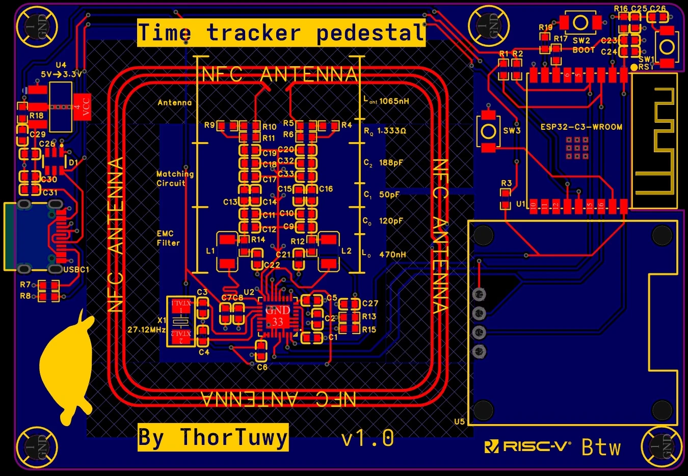
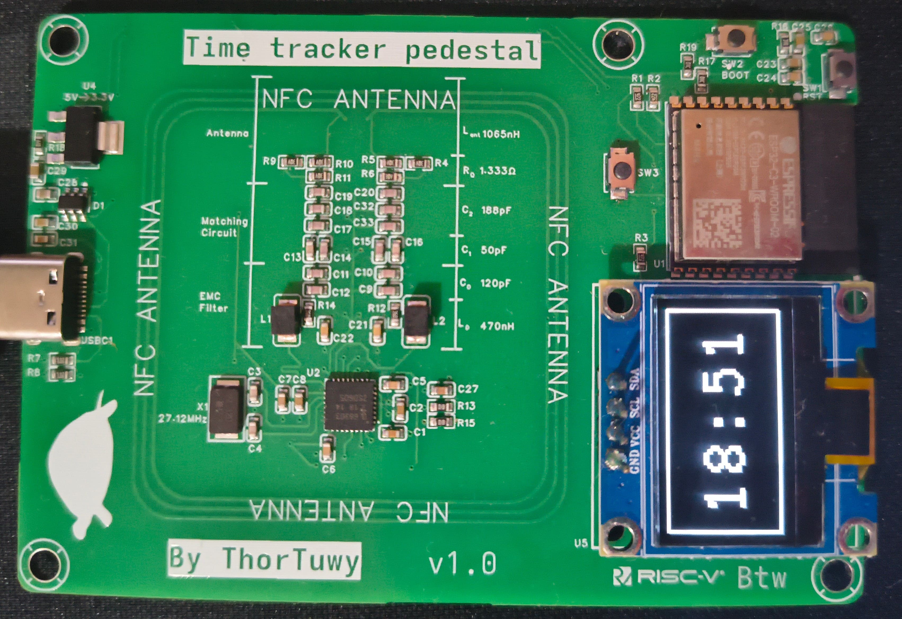
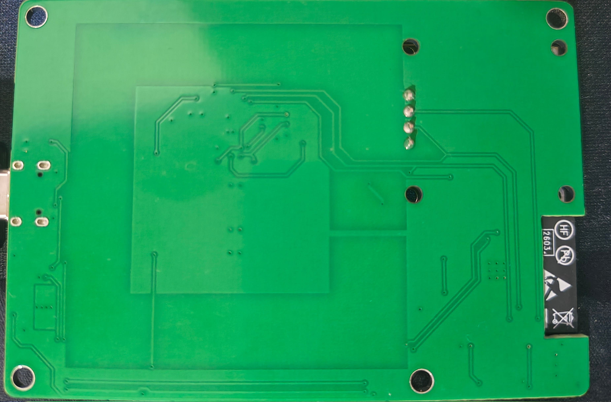

<br />
<div align="center">
  <a href="https://github.com/ThorTuwy/time-tracker-pedestal">
    
  </a>

  <p align="center">
    Track how you spend your time fully self-hosted and fun.
  </p>
  
  
  <div style="text-align: center;">
    
  </div>
</div>

# About the Project
Time-tracker-pedestal aims to be the way to track your time without needing to use SaaS or having your phone screaming at you face all day long.

The main idea of the project is to use NFC, in the form of cards or NFC status (yeah, that is the why of the name), to represent an activity. So then
You can start an activity by simply placing this NFC device on top of the pedestal, and boom clock starts ticking, as simple as it sounds.

And all of this happens fully inside the ESP32-C3 (🥳 RISC V 🥳), so you can sleep well knowing that only you know that you have studied 6 minutes this week for that exam that you have tomorrow C;

# Features

## Hardware
<p align="center">
  
  
</p>
<br/>

The main hardware features of the device are the following:
* ESP32-C3-WROOM used as the MCU.
* CLRC663 + Custom antenna design for the NFC reading/writing.
* A HS96L03W2C03 OLED display to display basic on-device information.
* USB-C (with data lines connected to the ESP32)

The full schematics and more detail about the hardware of the project can be found on the [OSHWLab page of this project](https://oshwlab.com/luzuomkpruebas/project_ldsdazez) (currently pending for approval).

## Software

On device, you can do the following (all of this through the OLED display):
* See time as a digital clock, and get a QR code for the website when no NFC device has been put on top.
* Track how much time you have been on an activity, and also see a summary of the hours spent this week and this month on it, when a NFC has been put on top.

The device also self-host a website, whose code can be found in the repo: [time-tracker-pedeastal-website](https://github.com/ThorTuwy/time-tracker-pedestal-website/), in which you can do:
* See a full weak calendar in which you can see all the activity you have done.
* See an overview of all types of activities that have happened on the device, and change its name and color.
* Change settings of the device (Wi-Fi credentials, NTP server, etc.). WIP!

# Developers

## Prerequisites

This project is build using platformio, so you would need to have it install:

https://platformio.org/install/integration

## Run the project
>[!WARNING]
>If you are trying to upload the firemware to a new time-tracker-device (or any ESP32) you would need
>to press and hold the BOOT button, press RESET button and while you are pressing start uploading the firmware
> (Only need it first time) 

The project does not have any simulation or things like that, so to run the project you would need an actual
time-tracker-pedestal device ( that you can order very easily through JLBPCB if you think this project is cool C; )

To flash the project to the device, you will need to connect the device to your computer via USB-C, and then you
can press the upload button (if you use the VSCode extension) or the following command if using the CLI:

```sh
pio run --target upload
```

Also, if it is your first time flashing the device or updating the /data folder (mainly to update the website),
you should update the filesystem image by pressing the "Upload filesystem image" in the menu that appears after pressing the PIO icon,
or with the following command on the CLI:

```sh
pio run -t uploadfs
```

